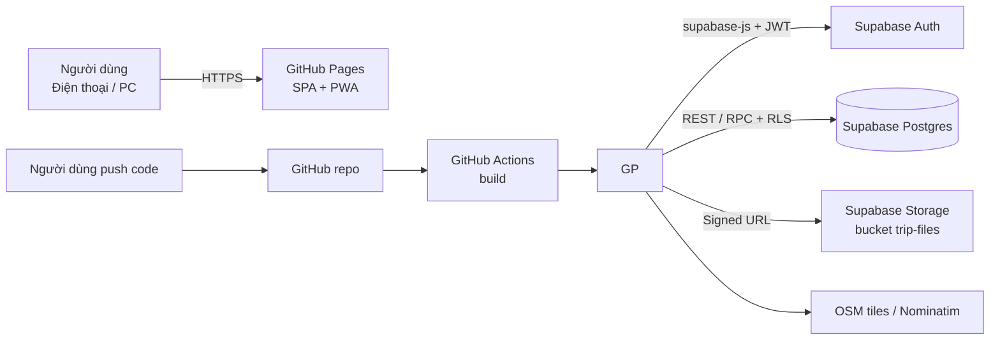

# PROMPT – XÂY DỰNG WEB APP "QUẢN LÝ DU LỊCH"

> React + TypeScript · Supabase · GitHub Pages · Responsive + PWA
> Phiên bản 1.0 · 27/11/2026 · Người lập: DucTM40 (PM/BA)

\---

## 0\. HƯỚNG DẪN SỬ DỤNG FILE NÀY (dành cho người dùng)

|Bước|Thao tác|
|-|-|
|1|Đặt file này tại `D:\\Claude\\quan-ly-du-lich\\PROMPT.md` (thư mục này cũng là nơi chứa source code)|
|2|Mở Claude Code hoặc Cowork, trỏ vào thư mục `D:\\Claude\\quan-ly-du-lich`|
|3|Dán **câu lệnh khởi động** ở mục 0.1|
|4|Claude làm theo từng giai đoạn (mục 14), hết mỗi giai đoạn sẽ báo cáo và dừng chờ bạn duyệt|
|5|Bạn tự commit/push lên GitHub → GitHub Actions tự build và deploy lên GitHub Pages|

> Dùng claude.ai (chat/Project): tải file này vào Project knowledge, dán câu lệnh khởi động. Claude sẽ xuất từng file dưới dạng khối code kèm đường dẫn để bạn tự lưu.

### 0.1 Câu lệnh khởi động (copy \& paste)

```text
Đọc toàn bộ file PROMPT.md trong thư mục này và làm theo đúng các quy tắc trong đó.
Bạn đóng vai Senior Full-stack Developer kiêm Solution Architect.
1) Tóm tắt phạm vi bạn hiểu (tối đa 15 dòng).
2) Hỏi tôi các câu hỏi bắt buộc ở mục 16 thuộc Giai đoạn 1, và mọi điểm bạn thấy chưa rõ/mâu thuẫn.
3) Chỉ bắt đầu code Giai đoạn 1 khi tôi xác nhận.
4) Hết mỗi giai đoạn: báo cáo theo mẫu mục 14.2 và DỪNG chờ tôi duyệt.
```

### 0.2 Câu lệnh tiếp tục ở phiên làm việc mới

```text
Đọc PROMPT.md và PROGRESS.md. Tóm tắt trạng thái hiện tại, sau đó tiếp tục giai đoạn đang dở.
```

\---

## 1\. VAI TRÒ VÀ MỤC TIÊU

|Mục|Nội dung|
|-|-|
|Vai trò của Claude|Senior Full-stack Developer (React/TypeScript), chuyên Supabase (PostgreSQL, RLS, Storage) và GitHub Actions|
|Sản phẩm|Web app quản lý chuyến du lịch cho **cá nhân/gia đình** và **nhóm bạn đi chung**|
|Chức năng chính|Lịch trình theo ngày · Chi tiêu đa tiền tệ · Chia tiền nhóm · Checklist · Bản đồ · Tệp đính kèm · Thành viên \& lời mời|
|Thiết bị|Mobile-first, dùng tốt trên điện thoại; cài được như app (PWA)|
|Chi phí vận hành|0đ: GitHub Pages + Supabase gói Free|
|Ngôn ngữ giao diện|Tiếng Việt|

\---

## 2\. THAM SỐ DỰ ÁN (người dùng có thể sửa trước khi chạy)

|Tham số|Giá trị|Ghi chú|
|-|-|-|
|Tên ứng dụng|`Quản Lý Du Lịch`|Header, title, manifest PWA|
|Tên ngắn PWA|`Du Lịch`|≤ 12 ký tự, hiện dưới icon trên điện thoại|
|Thư mục source|`D:\\Claude\\quan-ly-du-lich`|Claude tạo code tại đây|
|Tên repo GitHub|`quan-ly-du-lich`|Quyết định đường dẫn `https://<user>.github.io/<repo>/`|
|Nhánh deploy|`main`|Push vào `main` là tự deploy|
|Tiền tệ gốc mặc định|`VND`|Mỗi chuyến đi có thể chọn khác|
|Màu chủ đạo|Teal `#0f766e`||
|Giới hạn file đính kèm|10 MB/file||
|Supabase URL + key|**Hỏi người dùng tại Giai đoạn 2**|Không ghi cứng vào code|

\---

## 3\. QUY TẮC LÀM VIỆC BẮT BUỘC VỚI CLAUDE

|#|Quy tắc|
|-|-|
|R-01|**Không tự quyết** nội dung nghiệp vụ chưa có trong file này. Gặp điểm chưa rõ → hỏi, kèm 2–3 phương án, phương án đề xuất và lý do|
|R-02|Làm **tuần tự theo giai đoạn** (mục 14). Hết mỗi giai đoạn: báo cáo, cập nhật `PROGRESS.md`, **dừng chờ duyệt**|
|R-03|Cần thông tin Supabase (URL, key) → hỏi người dùng. Chỉ dùng **anon key / publishable key**. Tuyệt đối không dùng `service\_role` / secret key ở frontend|
|R-04|Không commit `.env`, `.env.local`. Chỉ commit `.env.example`|
|R-05|Không tự push GitHub. Người dùng tự push; Claude chỉ hướng dẫn lệnh git|
|R-06|Trước khi báo hoàn thành giai đoạn: `npm run typecheck`, `npm run test`, `npm run build` phải pass (nếu môi trường không chạy được thì nói rõ)|
|R-07|TypeScript `strict`, hạn chế `any`; component ≤ \~250 dòng; comment tiếng Việt ở chỗ có nghiệp vụ|
|R-08|Toàn bộ text giao diện tiếng Việt; lỗi hiển thị thân thiện theo mục 9.4|
|R-09|Mọi thay đổi CSDL viết thành **file migration mới** trong `supabase/migrations/`, không sửa file đã chạy trên Supabase|
|R-10|Thấy mâu thuẫn trong file này hoặc yêu cầu vượt khả năng gói Free → dừng và hỏi|
|R-11|Không thêm thư viện ngoài danh sách mục 4.1 khi chưa hỏi|

\---

## 4\. CÔNG NGHỆ VÀ KIẾN TRÚC

### 4.1 Công nghệ

|Lớp|Công nghệ|Lý do chọn|
|-|-|-|
|Frontend|React + Vite + TypeScript|Phổ biến, build nhanh, kiểu dữ liệu chặt|
|Giao diện|Tailwind CSS v4 + `lucide-react` (icon)|Responsive nhanh, nhẹ|
|Điều hướng|React Router (`BrowserRouter` + `basename`)|Kèm 404.html fallback cho GitHub Pages|
|Gọi dữ liệu|`@tanstack/react-query`|Cache, trạng thái loading/lỗi, làm mới dữ liệu|
|Backend|Supabase: Auth, Postgres, RLS, Storage, RPC|Không cần server riêng|
|Bản đồ|Leaflet + `react-leaflet` + tile OpenStreetMap|Miễn phí, không cần API key|
|Tìm tọa độ|Nominatim (OpenStreetMap)|Miễn phí; chỉ gọi khi bấm nút, ≤ 1 request/giây|
|PWA|`vite-plugin-pwa` (Workbox)|Cài lên màn hình chính, offline cơ bản|
|Kiểm thử|Vitest|Unit test logic tiền, ngày|
|CI/CD|GitHub Actions → GitHub Pages|Push `main` là tự deploy|

Dùng bản ổn định mới nhất tại thời điểm code, kiểm tra `peerDependencies` tương thích nhau.

### 4.2 Sơ đồ kiến trúc



### 4.3 Quyết định kỹ thuật bắt buộc

Các điểm dưới đây đã được phân tích và **chạy thử trên PostgreSQL**. Giữ nguyên, trừ khi người dùng yêu cầu đổi.

|Mã|Vấn đề|Quyết định|
|-|-|-|
|KT-01|GitHub Pages không hỗ trợ route của SPA (F5 ở `/trips/abc` bị 404)|Dùng `BrowserRouter` với `basename = import.meta.env.BASE\_URL`; khi build copy `dist/index.html` → `dist/404.html` (plugin Vite nhỏ)|
|KT-02|Site chạy dưới `/<repo>/`|`vite.config.ts`: `base = process.env.VITE\_BASE\_PATH \|\| '/'`. Workflow tự tính: repo tên `\*.github.io` → `/`, ngược lại `/<repo>/`|
|KT-03|Link xác nhận email / quên mật khẩu|`createClient(..., { auth: { flowType: 'pkce', detectSessionInUrl: true, persistSession: true } })`. Đăng ký: `emailRedirectTo = origin + BASE\_URL`; quên mật khẩu: `redirectTo = origin + BASE\_URL + 'reset-password'`. **Không dùng HashRouter** (xung đột token trên `#`). Lưu ý PKCE: mở link xác nhận trên trình duyệt/thiết bị khác sẽ không tự đăng nhập được (email vẫn đã xác nhận) → hiện thông báo "Email đã xác nhận, vui lòng đăng nhập"|
|KT-04|Key Supabase khi deploy|Biến build-time `VITE\_SUPABASE\_URL`, `VITE\_SUPABASE\_ANON\_KEY` lấy từ GitHub Secrets. Anon key là public, an toàn nhờ RLS|
|KT-05|Thiếu biến môi trường|Hiện màn hình "Chưa cấu hình Supabase" + hướng dẫn, app không bị trắng trang|
|KT-06|Tạo chuyến đi xong tự thêm Owner vào `trip\_members`|Trigger `AFTER INSERT` trên `trips`. Policy SELECT của `trips` **phải có** `owner\_id = auth.uid() OR is\_trip\_member(id)`, nếu không `insert().select()` lỗi RLS (RETURNING được kiểm tra trước khi trigger chạy)|
|KT-07|RLS đệ quy khi policy tra `trip\_members`|Dùng hàm `SECURITY DEFINER` + `set search\_path = public`: `trip\_role()`, `is\_trip\_member()`, `can\_edit\_trip()`, `is\_trip\_owner()`|
|KT-08|Xóa chuyến đi lỗi FK (cascade xóa thành viên trước khi xóa chi tiêu)|FK từ `expenses`, `expense\_splits`, `settlements` tới `trip\_members` dùng `ON DELETE CASCADE`, kèm trigger `BEFORE DELETE` trên `trip\_members` **chặn xóa lẻ** thành viên đã phát sinh chi tiêu; cho phép khi dòng `trips` cha đã bị xóa (đang xóa cả chuyến đi)|
|KT-09|Lưu khoản chi + phần chia phải toàn vẹn|RPC `save\_expense(p\_expense jsonb, p\_splits jsonb)` – `SECURITY INVOKER` (RLS vẫn áp dụng), chạy trong 1 transaction, kiểm tra tổng chia = số tiền|
|KT-10|Thành viên phải cùng chuyến đi với khoản chi|FK ghép `(trip\_id, member\_id) → trip\_members(trip\_id, id)`; `trip\_members` có `UNIQUE (trip\_id, id)`|
|KT-11|Tên file tiếng Việt bị Storage từ chối|Path: `<trip\_id>/<uuid>-<ten-khong-dau>`. Tên gốc lưu ở bảng `attachments`|
|KT-12|Policy Storage cần lấy `trip\_id` từ path|Hàm `storage\_trip\_id(name)` bắt exception, trả `NULL` nếu không phải uuid (tránh lỗi cast)|
|KT-13|Sai số làm tròn tiền|Tính theo **đơn vị nhỏ nhất** của tiền tệ (VND: 0 số lẻ, USD: 2) lấy từ `Intl.NumberFormat`, tối đa 2 số lẻ (khớp `numeric(18,2)`)|
|KT-14|Đăng xuất trên máy dùng chung|Xóa cache react-query + xóa cache Service Worker `supabase-api`|
|KT-15|Mở file trên iOS bị chặn popup|Mở `window.open('', '\_blank')` ngay khi bấm, sau khi có signed URL thì gán `location`|
|KT-16|Map nặng|Lazy-load trang Bản đồ (`React.lazy`), chỉ tải Leaflet khi mở tab|

\---

## 5\. NGƯỜI DÙNG VÀ PHÂN QUYỀN

### 5.1 Vai trò

|Vai trò|Mô tả|
|-|-|
|Owner – Chủ chuyến đi|Người tạo chuyến đi. Toàn quyền. Mỗi chuyến đi đúng 1 Owner|
|Editor – Được chỉnh sửa|Thêm/sửa/xóa dữ liệu của chuyến đi|
|Viewer – Chỉ xem|Xem toàn bộ, không sửa|
|Được mời (invited)|Đã được thêm bằng email, chưa chấp nhận. Chỉ thấy lời mời của mình|
|Thành viên offline|Không dùng app (trẻ em, ông bà…). Chỉ dùng để chia tiền, giao việc checklist|

### 5.2 Ma trận quyền (enforce bằng RLS ở server; UI chỉ ẩn/khóa nút)

|Chức năng|Owner|Editor|Viewer|Không phải thành viên|
|-|:-:|:-:|:-:|:-:|
|Xem chuyến đi và toàn bộ dữ liệu|✔|✔|✔|✘|
|Sửa thông tin chuyến đi, tỷ giá|✔|✔|✘|✘|
|Thêm/sửa/xóa lịch trình, chi tiêu, thanh toán, checklist, tệp|✔|✔|✘|✘|
|Thêm/sửa/xóa thành viên, đổi vai trò|✔|✘|✘|✘|
|Xóa chuyến đi|✔|✘|✘|✘|
|Rời chuyến đi|✘|✔|✔|–|
|Xem/chấp nhận/từ chối lời mời gửi tới email của mình|–|–|–|✔|

\---

## 6\. YÊU CẦU CHỨC NĂNG

### 6.1 AUTH – Đăng nhập, tài khoản

|ID|Chức năng|Tiêu chí chấp nhận|
|-|-|-|
|AUTH-01|Đăng ký|Họ tên\*, Email\*, Mật khẩu\* (≥ 8 ký tự), Nhập lại mật khẩu\*. Bật xác nhận email → báo "Kiểm tra email"; tắt → vào thẳng app. Tự tạo `profiles` bằng trigger|
|AUTH-02|Đăng nhập|Email + mật khẩu. Sai → "Email hoặc mật khẩu không đúng"|
|AUTH-03|Quên mật khẩu|Nhập email → nhận link → trang `/reset-password` đặt mật khẩu mới. Link hết hạn → báo rõ, cho gửi lại|
|AUTH-04|Trang Tài khoản|Sửa họ tên (cập nhật `profiles` + `user\_metadata`), đổi mật khẩu, nút Cài ứng dụng (PWA-04), Đăng xuất|
|AUTH-05|Đăng xuất|Xóa phiên + cache (KT-14)|
|AUTH-06|Giữ phiên|Đóng/mở lại app vẫn đăng nhập; token tự làm mới|
|AUTH-07|Bảo vệ route|Chưa đăng nhập vào trang nội bộ → chuyển `/login`, đăng nhập xong quay lại trang cũ|

### 6.2 TRIP – Chuyến đi

|ID|Chức năng|Tiêu chí chấp nhận|
|-|-|-|
|TRIP-01|Danh sách chuyến đi|3 nhóm: Đang diễn ra / Sắp tới / Đã qua. Card: tên, điểm đến, khoảng ngày, số ngày, vai trò của tôi. Trống → empty state + nút Tạo|
|TRIP-02|Tạo chuyến đi|Tên\* (≤ 200), Điểm đến, Ngày bắt đầu\*, Ngày kết thúc\* (≥ bắt đầu, tối đa 365 ngày), Tiền tệ gốc (mặc định VND), Ngân sách (≥ 0), Mô tả. Người tạo = Owner. Tạo xong mở trang chi tiết|
|TRIP-03|Sửa chuyến đi|Owner/Editor. Đổi ngày làm một số hoạt động lịch trình nằm ngoài khoảng ngày → hiện ở nhóm "Ngoài thời gian chuyến đi", **không tự xóa**|
|TRIP-04|Xóa chuyến đi|Chỉ Owner. Xác nhận bằng cách gõ lại tên chuyến đi. Xóa file trên Storage trước, sau đó xóa `trips` (cascade)|
|TRIP-05|Tổng quan|Số ngày; Tổng chi (quy đổi) so với Ngân sách (thanh tiến độ, đỏ khi vượt); Chi theo hạng mục (thanh ngang); Tiến độ checklist; 3 hoạt động sắp tới; Số thành viên|
|TRIP-06|Tab chuyến đi|Tổng quan · Lịch trình · Chi tiêu · Chia tiền · Checklist · Bản đồ · Tệp · Thành viên · Cài đặt. Mobile: thanh tab cuộn ngang|

### 6.3 MEM – Thành viên và lời mời

|ID|Chức năng|Tiêu chí chấp nhận|
|-|-|-|
|MEM-01|Danh sách thành viên|Tên, email, vai trò, trạng thái (Đã tham gia / Đang chờ / Không dùng app), đánh dấu "Bạn"|
|MEM-02|Thêm thành viên (Owner)|Tên hiển thị\*, Email (tùy chọn), Vai trò (Editor/Viewer). Có email → trạng thái `invited`; không email → thành viên offline. Email trùng trong chuyến đi → báo lỗi|
|MEM-03|Nhận lời mời|Người được mời đăng ký/đăng nhập **đúng email** → trang chủ hiện khối "Lời mời" (tên chuyến, ngày, người mời, vai trò) → Chấp nhận / Từ chối (RPC)|
|MEM-04|Chia sẻ lời mời|Giai đoạn đầu app **không tự gửi email mời**. Nút "Sao chép lời mời" tạo đoạn text gồm link app + hướng dẫn đăng ký đúng email, để gửi qua Zalo/Messenger|
|MEM-05|Quản lý (Owner)|Đổi vai trò Editor ↔ Viewer, sửa tên/email của thành viên chưa có tài khoản, xóa thành viên. Đã có chi tiêu/phần chia/thanh toán → chặn, báo rõ lý do|
|MEM-06|Rời chuyến đi|Editor/Viewer tự rời. Đã phát sinh chi tiêu → chặn|

### 6.4 ITI – Lịch trình

|ID|Chức năng|Tiêu chí chấp nhận|
|-|-|-|
|ITI-01|Xem theo ngày|Mỗi ngày 1 khối: "Ngày 1 · T7, 20/12/2026". Trong ngày sắp theo giờ bắt đầu (không có giờ xếp cuối), rồi `sort\_order`|
|ITI-02|Thêm/sửa/xóa hoạt động|Ngày\* (chọn trong khoảng chuyến đi), Giờ bắt đầu, Giờ kết thúc (≥ bắt đầu), Tiêu đề\*, Hạng mục (Di chuyển / Lưu trú / Ăn uống / Tham quan / Mua sắm / Khác), Tên địa điểm, Địa chỉ, Vĩ độ, Kinh độ, Chi phí dự kiến (tiền tệ gốc), Ghi chú|
|ITI-03|Tìm tọa độ|Nút "Tìm tọa độ" gọi Nominatim theo tên + địa chỉ, hiện ≤ 5 kết quả để chọn; không tìm thấy → báo, cho nhập tay|
|ITI-04|Chỉ đường|Nút mở Google Maps theo tọa độ (hoặc tên + địa chỉ nếu chưa có tọa độ)|
|ITI-05|Tổng chi phí dự kiến|Theo từng ngày và toàn chuyến|

### 6.5 EXP – Chi tiêu (đa tiền tệ)

|ID|Chức năng|Tiêu chí chấp nhận|
|-|-|-|
|EXP-01|Danh sách chi tiêu|Nhóm theo ngày (mới nhất trước), lọc theo hạng mục. Mỗi dòng: tên, hạng mục, người trả, số người chia, số tiền nguyên tệ + quy đổi (nếu khác tiền tệ gốc), icon kẹp giấy nếu có file|
|EXP-02|Thêm/sửa/xóa khoản chi|Tên\*, Số tiền\* (> 0), Tiền tệ (tiền tệ gốc + các tiền tệ đã khai báo tỷ giá), Tỷ giá (tự điền từ cài đặt, cho sửa; tiền tệ gốc = 1 và khóa), Ngày chi (mặc định hôm nay), Hạng mục, Người trả\*, Cách chia, Ghi chú|
|EXP-03|Chia đều|Chọn người tham gia (mặc định tất cả), hiển thị số tiền mỗi người theo BR-05|
|EXP-04|Chia tùy chỉnh|Nhập số tiền từng người; hiển thị "Còn thiếu / Thừa X". Chỉ cho lưu khi khớp 100%|
|EXP-05|Lưu|Qua RPC `save\_expense` (KT-09). Lỗi → giữ nguyên dữ liệu trên form|
|EXP-06|Tổng hợp|Tổng chi quy đổi, số khoản chi, so với ngân sách|

### 6.6 BAL – Chia tiền và thanh toán

|ID|Chức năng|Tiêu chí chấp nhận|
|-|-|-|
|BAL-01|Bảng cân đối|Mỗi thành viên (tiền tệ gốc): Đã trả · Phải chịu · Đã chuyển · Đã nhận · **Còn lại** (+ xanh: được nhận; − đỏ: phải trả)|
|BAL-02|Gợi ý chuyển tiền|Danh sách "A → B: số tiền" với ít giao dịch nhất (BR-08)|
|BAL-03|Ghi nhận đã trả|Bấm trên gợi ý → tạo `settlements`. Có thêm form ghi nhận thủ công: Người trả, Người nhận (khác nhau), Số tiền > 0, Ngày, Ghi chú|
|BAL-04|Lịch sử thanh toán|Danh sách, xóa được (Owner/Editor)|
|BAL-05|Sao chép kết quả|Nút "Sao chép bảng chia tiền" ra text để gửi Zalo|
|BAL-06|Kiểm soát|Tổng cột "Còn lại" của mọi thành viên luôn = 0|

### 6.7 CHK – Checklist

|ID|Chức năng|Tiêu chí chấp nhận|
|-|-|-|
|CHK-01|Hiển thị|3 nhóm: Hành lý / Giấy tờ / Việc cần làm. Thanh tiến độ tổng (đã xong / tổng)|
|CHK-02|Thêm nhanh|Tiêu đề\* + Nhóm + Người phụ trách (tùy chọn) + Hạn (tùy chọn) trên 1 dòng (mobile xuống dòng)|
|CHK-03|Cập nhật|Đánh dấu xong/chưa (gạch ngang khi xong), sửa, xóa|
|CHK-04|Mẫu gợi ý|Khi checklist trống: nút "Thêm mẫu gợi ý": CCCD/Hộ chiếu, Vé máy bay/tàu xe, Xác nhận đặt phòng, Bảo hiểm du lịch, Đổi ngoại tệ, SIM/eSIM, Sạc dự phòng, Thuốc cá nhân, Kem chống nắng, Quần áo|

### 6.8 MAP – Bản đồ

|ID|Chức năng|Tiêu chí chấp nhận|
|-|-|-|
|MAP-01|Hiển thị điểm|Các hoạt động có tọa độ, marker đánh số theo thứ tự; lọc theo ngày (mặc định: tất cả)|
|MAP-02|Tuyến trong ngày|Khi lọc 1 ngày: nối các điểm bằng đường thẳng theo thứ tự thời gian|
|MAP-03|Popup|Tên, ngày giờ, nút Chỉ đường|
|MAP-04|Khung nhìn|Tự fit theo các điểm; không có điểm → hiện Việt Nam (16.0, 106.0, zoom 5)|
|MAP-05|Thiếu tọa độ|Danh sách các hoạt động chưa có tọa độ + link sang Lịch trình|
|MAP-06|Bản quyền|Hiển thị attribution "© OpenStreetMap contributors"|

### 6.9 FILE – Tệp đính kèm

|ID|Chức năng|Tiêu chí chấp nhận|
|-|-|-|
|FILE-01|Tải lên|Ảnh, PDF, file khác; ≤ 10 MB; bucket private `trip-files`; tùy chọn gắn với 1 khoản chi hoặc 1 hoạt động. Trên điện thoại cho phép chụp ảnh trực tiếp|
|FILE-02|Danh sách|Icon theo loại, tên gốc, dung lượng, ngày tải, gắn với gì|
|FILE-03|Mở/tải|Signed URL hết hạn sau 5 phút (KT-15)|
|FILE-04|Xóa|Owner/Editor; xóa object trên Storage rồi xóa dòng `attachments`|

### 6.10 SET – Cài đặt chuyến đi

|ID|Chức năng|Tiêu chí chấp nhận|
|-|-|-|
|SET-01|Sửa thông tin|Như TRIP-02|
|SET-02|Tỷ giá|Thêm tiền tệ + tỷ giá dạng "1 USD = 25.400 VND"; sửa; xóa. Tỷ giá chỉ là giá trị mặc định khi nhập khoản chi mới (BR-04)|
|SET-03|Vùng nguy hiểm|Xóa chuyến đi (TRIP-04) – chỉ Owner thấy|

### 6.11 PWA và Responsive

|ID|Chức năng|Tiêu chí chấp nhận|
|-|-|-|
|PWA-01|Manifest|name, short\_name, `lang: vi`, `display: standalone`, theme/background color, icon 192, 512, maskable 512, `apple-touch-icon` 180; `start\_url` và `scope` = base path|
|PWA-02|Service Worker|`registerType: autoUpdate`; cache app shell; `navigateFallback: index.html`; GET `/rest/v1/\*` dùng **NetworkFirst** (timeout 5s); tile OSM dùng **CacheFirst** (≤ 400 ô, 30 ngày)|
|PWA-03|Offline|Banner "Bạn đang offline – dữ liệu có thể chưa mới nhất"; khi offline khóa các nút ghi dữ liệu; vẫn xem được dữ liệu đã mở trước đó|
|PWA-04|Cài ứng dụng|Android/PC: nút "Cài ứng dụng" (sự kiện `beforeinstallprompt`). iOS: hướng dẫn Chia sẻ → Thêm vào MH chính|
|RESP-01|Mobile-first|Breakpoint `md` (≥ 768px) cho desktop. Mobile: thanh điều hướng dưới, form dạng bottom sheet, vùng chạm ≥ 44px, hỗ trợ safe-area iOS. Desktop: nội dung tối đa \~1024px, form dạng modal giữa màn hình|

\---

## 7\. QUY TẮC NGHIỆP VỤ (BR)

|Mã|Quy tắc|
|-|-|
|BR-01|Ngày kết thúc ≥ ngày bắt đầu; tối đa 365 ngày/chuyến|
|BR-02|Mỗi chuyến đi đúng 1 Owner; không chuyển quyền Owner trong phạm vi bản đầu|
|BR-03|Email thành viên duy nhất trong 1 chuyến đi (không phân biệt hoa/thường)|
|BR-04|Quy đổi: `amount\_base = amount × exchange\_rate`, tỷ giá = số đơn vị tiền tệ gốc cho 1 đơn vị ngoại tệ. Tỷ giá **chốt theo từng khoản chi**; sửa tỷ giá trong Cài đặt không ảnh hưởng khoản đã nhập|
|BR-05|Chia đều theo đơn vị nhỏ nhất, phần dư cộng lần lượt cho người đầu danh sách. VD: 100.000 VND / 3 = 33.334 + 33.333 + 33.333; 10 USD / 3 = 3,34 + 3,33 + 3,33|
|BR-06|Chia tùy chỉnh: tổng phần chia phải **bằng đúng** số tiền chi (kiểm tra ở cả client và RPC)|
|BR-07|Số dư thành viên (tiền tệ gốc) = Đã trả − Phải chịu + Đã chuyển − Đã nhận. Tính theo đơn vị nhỏ nhất; phần chênh do làm tròn khi quy đổi dồn vào phần chia cuối của khoản chi đó để tổng số dư luôn = 0|
|BR-08|Gợi ý thanh toán: ghép người nợ nhiều nhất với người được nhận nhiều nhất, lặp tới khi hết (greedy)|
|BR-09|Không xóa thành viên/không cho rời chuyến đi khi đã có khoản chi, phần chia hoặc thanh toán liên quan|
|BR-10|Không cho đổi tiền tệ gốc khi chuyến đi đã có khoản chi (vì tỷ giá đã chốt)|
|BR-11|Lời mời gắn với email đăng nhập; chỉ tài khoản có đúng email mới chấp nhận được. Môi trường thật **phải bật xác nhận email** để tránh mạo danh (xem Q-03)|
|BR-12|File ≤ 10 MB; path trên Storage bắt đầu bằng `trip\_id`|
|BR-13|Khoản chi được phép có ngày ngoài thời gian chuyến đi (chi trước: vé, đặt phòng)|
|BR-14|Hoạt động lịch trình phải có ngày trong khoảng chuyến đi khi tạo/sửa|

\---

## 8\. THIẾT KẾ DỮ LIỆU (Supabase / PostgreSQL)

### 8.1 ERD

```mermaid
erDiagram
  AUTH\_USERS ||--|| PROFILES : "1-1"
  AUTH\_USERS ||--o{ TRIPS : "owner"
  TRIPS ||--o{ TRIP\_MEMBERS : "có"
  AUTH\_USERS |o--o{ TRIP\_MEMBERS : "liên kết"
  TRIPS ||--o{ TRIP\_CURRENCIES : "tỷ giá"
  TRIPS ||--o{ ITINERARY\_ITEMS : "lịch trình"
  TRIPS ||--o{ EXPENSES : "chi tiêu"
  EXPENSES ||--|{ EXPENSE\_SPLITS : "chia cho"
  TRIP\_MEMBERS ||--o{ EXPENSES : "người trả"
  TRIP\_MEMBERS ||--o{ EXPENSE\_SPLITS : "phải chịu"
  TRIPS ||--o{ SETTLEMENTS : "thanh toán"
  TRIP\_MEMBERS ||--o{ SETTLEMENTS : "từ / tới"
  TRIPS ||--o{ CHECKLIST\_ITEMS : "checklist"
  TRIP\_MEMBERS |o--o{ CHECKLIST\_ITEMS : "phụ trách"
  TRIPS ||--o{ ATTACHMENTS : "tệp"
  EXPENSES |o--o{ ATTACHMENTS : "gắn"
  ITINERARY\_ITEMS |o--o{ ATTACHMENTS : "gắn"
```

### 8.2 Bảng và cột

Quy ước chung: `id uuid PK default gen\_random\_uuid()`; `created\_at`, `updated\_at timestamptz default now()` (trigger cập nhật `updated\_at`); `created\_by uuid default auth.uid()`; giá trị danh mục dùng `text + CHECK` (dễ mở rộng hơn enum).

|Bảng|Cột chính|Ràng buộc|
|-|-|-|
|`profiles`|`id` (PK = auth.users.id), `email`, `full\_name`|Trigger `on\_auth\_user\_created` tự tạo từ `raw\_user\_meta\_data.full\_name`|
|`trips`|`name`, `destination`, `description`, `start\_date`, `end\_date`, `base\_currency` (mặc định `VND`), `budget numeric(18,2)`, `owner\_id` (default `auth.uid()`)|`end\_date ≥ start\_date`; `base\_currency \~ '^\[A-Z]{3}$'`; trigger giữ nguyên `owner\_id` khi UPDATE; trigger AFTER INSERT thêm Owner vào `trip\_members`|
|`trip\_members`|`trip\_id`, `user\_id` (null được), `display\_name`, `email`, `role` (`owner/editor/viewer`), `status` (`invited/active`)|`UNIQUE(trip\_id, user\_id)`; `UNIQUE(trip\_id, id)`; unique `(trip\_id, lower(email))`; unique 1 owner/trip (partial index); `invited` ⇒ có email và `user\_id` null; trigger chặn đổi role owner, chặn gắn `user\_id` của người khác; trigger chặn xóa (KT-08)|
|`trip\_currencies`|PK `(trip\_id, currency)`, `rate\_to\_base numeric(18,6) > 0`||
|`itinerary\_items`|`trip\_id`, `day\_date`, `start\_time`, `end\_time`, `title`, `category`, `location\_name`, `address`, `lat`, `lng`, `cost\_estimate`, `note`, `sort\_order`|`category ∈ (di\_chuyen, luu\_tru, an\_uong, tham\_quan, mua\_sam, khac)`; lat ∈ \[-90, 90], lng ∈ \[-180, 180]; index `(trip\_id, day\_date, start\_time)`|
|`expenses`|`trip\_id`, `title`, `category`, `amount numeric(18,2) > 0`, `currency`, `exchange\_rate numeric(18,6) > 0`, `amount\_base` (**generated** = `round(amount × exchange\_rate, 2)`), `paid\_by`, `expense\_date`, `split\_type` (`equal/custom`), `note`|`UNIQUE(id, trip\_id)`; FK `(trip\_id, paid\_by) → trip\_members(trip\_id, id) ON DELETE CASCADE`|
|`expense\_splits`|PK `(expense\_id, member\_id)`, `trip\_id`, `share\_amount numeric(18,2) ≥ 0`|FK `(expense\_id, trip\_id) → expenses(id, trip\_id) ON DELETE CASCADE`; FK `(trip\_id, member\_id) → trip\_members ON DELETE CASCADE`|
|`settlements`|`trip\_id`, `from\_member`, `to\_member`, `amount numeric(18,2) > 0` (tiền tệ gốc), `settled\_on`, `note`|`from\_member ≠ to\_member`; FK ghép tới `trip\_members` `ON DELETE CASCADE`|
|`checklist\_items`|`trip\_id`, `title`, `category` (`hanh\_ly/giay\_to/viec\_can\_lam`), `assignee\_id`, `is\_done`, `due\_date`, `sort\_order`|FK `(trip\_id, assignee\_id) → trip\_members ON DELETE SET NULL (assignee\_id)`|
|`attachments`|`trip\_id`, `storage\_path` (unique), `file\_name`, `mime\_type`, `size\_bytes`, `expense\_id`, `itinerary\_item\_id`, `uploaded\_by`|FK `expense\_id`, `itinerary\_item\_id` `ON DELETE SET NULL`; CHECK `storage\_trip\_id(storage\_path) = trip\_id`|

Mọi bảng có `trip\_id` → `trips(id) ON DELETE CASCADE`.

### 8.3 Hàm RPC

|Hàm|Loại|Mô tả|
|-|-|-|
|`my\_invitations()`|SECURITY DEFINER|Lời mời đang chờ của email đang đăng nhập (`auth.jwt()->>'email'`): member\_id, trip\_id, tên chuyến, điểm đến, ngày, vai trò, người mời|
|`accept\_invitation(p\_member\_id)`|SECURITY DEFINER|Kiểm tra đúng email + đang `invited` + chưa là thành viên → gán `user\_id = auth.uid()`, `status = active`; trả `trip\_id`|
|`decline\_invitation(p\_member\_id)`|SECURITY DEFINER|Xóa dòng mời nếu đúng email|
|`save\_expense(p\_expense jsonb, p\_splits jsonb)`|SECURITY INVOKER|Thêm/sửa khoản chi + thay toàn bộ phần chia trong 1 transaction; lỗi nếu không có người chia hoặc tổng chia ≠ số tiền|
|`trip\_role / is\_trip\_member / can\_edit\_trip / is\_trip\_owner(trip\_id)`|SECURITY DEFINER|Dùng trong policy (KT-07)|
|`storage\_trip\_id(name)`|IMMUTABLE|KT-12|

Thu hồi quyền `EXECUTE` của `anon` với các RPC, chỉ cấp cho `authenticated`.

### 8.4 RLS (bật cho tất cả bảng, policy chỉ cho role `authenticated`)

|Bảng|SELECT|INSERT|UPDATE|DELETE|
|-|-|-|-|-|
|`profiles`|`id = auth.uid()`|(trigger)|`id = auth.uid()`|–|
|`trips`|`owner\_id = auth.uid() OR is\_trip\_member(id)`|`owner\_id = auth.uid()`|`can\_edit\_trip(id)`|`owner\_id = auth.uid()`|
|`trip\_members`|`is\_trip\_member(trip\_id)`|`is\_trip\_owner(trip\_id) AND role <> 'owner' AND user\_id IS NULL`|`is\_trip\_owner(trip\_id)`|Owner xóa người khác (`role <> 'owner'`), hoặc tự rời (`user\_id = auth.uid() AND role <> 'owner'`)|
|Các bảng dữ liệu chuyến đi (`trip\_currencies`, `itinerary\_items`, `expenses`, `expense\_splits`, `settlements`, `checklist\_items`, `attachments`)|`is\_trip\_member(trip\_id)`|`can\_edit\_trip(trip\_id)`|`can\_edit\_trip(trip\_id)`|`can\_edit\_trip(trip\_id)`|

`anon`: thu hồi toàn bộ quyền trên các bảng nghiệp vụ.

### 8.5 Storage

|Mục|Giá trị|
|-|-|
|Bucket|`trip-files`, **private**, `file\_size\_limit` = 10 MB|
|Path|`<trip\_id>/<uuid>-<ten-khong-dau>.<ext>`|
|Policy SELECT|`bucket\_id = 'trip-files' AND is\_trip\_member(storage\_trip\_id(name))`|
|Policy INSERT/UPDATE/DELETE|`bucket\_id = 'trip-files' AND can\_edit\_trip(storage\_trip\_id(name))`|

### 8.6 Kiểm thử SQL bắt buộc (Giai đoạn 2)

Tạo `supabase/tests/00\_supabase\_stub.sql` (giả lập `auth.users`, `auth.uid()`, `auth.jwt()`, `storage.buckets/objects`, role `anon/authenticated`) và `supabase/tests/01\_rls\_scenario.sql`, chạy trên PostgreSQL local (nếu môi trường có). Kịch bản tối thiểu:

|TC|Kịch bản|Kỳ vọng|
|-|-|-|
|DB-01|A tạo chuyến đi bằng `insert ... returning`|Thành công; `trip\_members` có A là owner|
|DB-02|A thêm thành viên có `user\_id` của người khác|Lỗi RLS|
|DB-03|C (không liên quan) đọc trips/expenses/members/files|0 dòng|
|DB-04|B được mời → `my\_invitations()` → `accept\_invitation()`|B thấy chuyến đi|
|DB-05|B (editor) `save\_expense` chia đều VND và tùy chỉnh USD|Thành công; `amount\_base` đúng|
|DB-06|Tổng chia ≠ số tiền|Lỗi tiếng Việt|
|DB-07|Viewer `save\_expense` / upload file|Lỗi RLS|
|DB-08|Editor đổi vai trò thành viên|UPDATE 0 dòng|
|DB-09|Owner hạ quyền chính mình / gắn tài khoản người khác|Lỗi trigger|
|DB-10|Owner xóa thành viên đã có chi tiêu|Lỗi "đã phát sinh chi tiêu"|
|DB-11|Attachment có path thuộc trip khác|Lỗi CHECK|
|DB-12|Owner sửa `owner\_id`|Bị giữ nguyên|
|DB-13|Owner xóa chuyến đi có đủ dữ liệu|Thành công, mọi bảng con về 0|

\---

## 9\. GIAO DIỆN (UI/UX)

### 9.1 Danh sách màn hình / route

|Route|Màn hình|Quyền|
|-|-|-|
|`/login`, `/register`, `/forgot-password`, `/reset-password`|Xác thực|Công khai|
|`/`|Chuyến đi của tôi + Lời mời|Đăng nhập|
|`/trips/new`|Tạo chuyến đi|Đăng nhập|
|`/trips/:tripId`|Tổng quan|Thành viên|
|`/trips/:tripId/itinerary` · `expenses` · `balances` · `checklist` · `map` · `files` · `members` · `settings`|Các tab chuyến đi|Thành viên (nút ghi theo quyền)|
|`/profile`|Tài khoản|Đăng nhập|
|`\*`|404|–|

### 9.2 Bố cục

|Thành phần|Mobile (< 768px)|Desktop (≥ 768px)|
|-|-|-|
|Header|Logo + tên app, sticky|Logo + menu ngang + tên người dùng|
|Điều hướng chính|Thanh dưới: Chuyến đi · Tạo mới · Tài khoản|Menu trên header|
|Tab chuyến đi|Cuộn ngang, icon + chữ|Hàng tab đầy đủ|
|Form|Bottom sheet, nút Lưu cố định cuối|Modal giữa màn hình|
|Danh sách|Card 1 cột|Lưới 2–3 cột (danh sách chuyến đi)|

Thành phần UI dùng chung: Button (primary/secondary/danger/ghost, trạng thái loading), Input, Select, Textarea, Field (label + lỗi), Card, Badge, Modal/BottomSheet, EmptyState, Spinner/Skeleton, Toast.

### 9.3 Định dạng

|Loại|Định dạng|
|-|-|
|Tiền|`Intl.NumberFormat('vi-VN', { style: 'currency' })` → `1.250.000 ₫`, `10,50 US$`|
|Ngày|`dd/MM/yyyy`; có thứ: `T7, 20/12/2026`|
|Giờ|`HH:mm`|
|Parse ngày `YYYY-MM-DD`|Theo giờ địa phương (không dùng `new Date('YYYY-MM-DD')` để tránh lệch múi giờ)|

### 9.4 Thông báo lỗi chuẩn

|Lỗi gốc|Hiển thị|
|-|-|
|`Invalid login credentials`|Email hoặc mật khẩu không đúng|
|`User already registered`|Email này đã được đăng ký|
|`Email not confirmed`|Email chưa được xác nhận, vui lòng kiểm tra hộp thư|
|`violates row-level security` / `42501`|Bạn không có quyền thực hiện thao tác này|
|Trùng `trip\_members\_trip\_email`|Email này đã có trong danh sách thành viên|
|`Failed to fetch` / mất mạng|Không kết nối được máy chủ, vui lòng kiểm tra mạng|
|Lỗi do RPC/trigger raise (tiếng Việt)|Hiển thị nguyên văn|
|Khác|"Có lỗi xảy ra" + chi tiết thu gọn|

### 9.5 Trạng thái màn hình

Mọi màn hình có đủ 4 trạng thái: Đang tải (skeleton/spinner) · Trống (empty state + hành động gợi ý) · Lỗi (thông báo + nút Thử lại) · Có dữ liệu. Thao tác xóa luôn hỏi xác nhận.

\---

## 10\. YÊU CẦU PHI CHỨC NĂNG

|Nhóm|Yêu cầu|
|-|-|
|Bảo mật|Mọi quyền enforce bằng RLS; không có service key ở frontend; không log token; Storage private + signed URL|
|Hiệu năng|Tải lần đầu < 3s trên 4G; JS bundle chính < 300 KB gzip (lazy-load bản đồ)|
|Trình duyệt|Chrome/Edge mới nhất, Safari iOS 16+, Chrome Android|
|Truy cập|Label cho input, tương phản đủ, focus rõ, vùng chạm ≥ 44px|
|Nhất quán dữ liệu|Sau mỗi thao tác ghi: invalidate query liên quan (chi tiêu → cân đối, tổng quan)|
|Giới hạn gói Free|Supabase: 500 MB DB, 1 GB Storage, project tạm dừng sau 7 ngày không dùng. GitHub Pages: repo **public** (repo private cần gói trả phí)|

\---

## 11\. CẤU TRÚC THƯ MỤC MONG MUỐN

```text
quan-ly-du-lich/
├─ PROMPT.md                  # file này
├─ PROGRESS.md                # Claude cập nhật sau mỗi giai đoạn
├─ README.md                  # hướng dẫn cài đặt, chạy, deploy (tiếng Việt)
├─ .env.example
├─ .gitignore
├─ index.html
├─ package.json / package-lock.json
├─ vite.config.ts / vitest.config.ts / tsconfig\*.json
├─ .github/workflows/deploy.yml
├─ public/                    # favicon.svg, pwa-192.png, pwa-512.png, pwa-maskable-512.png, apple-touch-icon.png
├─ supabase/
│  ├─ migrations/001\_init.sql
│  └─ tests/                  # 00\_supabase\_stub.sql, 01\_rls\_scenario.sql
└─ src/
   ├─ main.tsx, App.tsx, index.css, types.ts
   ├─ lib/                    # supabase.ts, api.ts, format.ts, split.ts, settle.ts, constants.ts, errors.ts, geocode.ts, \*.test.ts
   ├─ auth/                   # AuthProvider.tsx, RequireAuth.tsx
   ├─ hooks/                  # queries.ts (react-query), useOnline.ts, useInstallPrompt.ts
   ├─ components/             # ui.tsx, Modal.tsx, Toast.tsx, Layout.tsx, AuthLayout.tsx, ConfigMissing.tsx, TripForm.tsx
   └─ pages/
      ├─ LoginPage, RegisterPage, ForgotPasswordPage, ResetPasswordPage
      ├─ TripsPage, NewTripPage, TripDetailPage, ProfilePage, NotFoundPage
      └─ trip/                # OverviewTab, ItineraryTab, ItineraryForm, ExpensesTab, ExpenseForm,
                              # BalancesTab, ChecklistTab, MapTab, FilesTab, MembersTab, SettingsTab
```

\---

## 12\. TRIỂN KHAI (Claude phải viết đầy đủ vào README.md)

### 12.1 Supabase

|Bước|Thao tác|
|-|-|
|1|Tạo project tại supabase.com (region Singapore cho gần VN)|
|2|SQL Editor → chạy `supabase/migrations/001\_init.sql` (1 lần, trên project mới)|
|3|Kiểm tra: Table Editor có 10 bảng; Storage có bucket `trip-files`|
|4|Authentication → URL Configuration: **Site URL** = `https://<user>.github.io/<repo>/`; **Redirect URLs** thêm `https://<user>.github.io/<repo>/\*\*` và `http://localhost:5173/\*\*`|
|5|Authentication → Providers → Email: bật Email; chọn bật/tắt "Confirm email" theo Q-03; đặt độ dài mật khẩu tối thiểu = 8|
|6|(Nếu bật xác nhận email cho người dùng thật) cấu hình SMTP riêng – xem Q-03|
|7|Project Settings → API: lấy Project URL + anon/publishable key → đưa cho Claude ở Giai đoạn 2 hoặc tự điền|

### 12.2 GitHub

|Bước|Thao tác|
|-|-|
|1|Tạo repo `quan-ly-du-lich` (public)|
|2|Settings → Secrets and variables → Actions: thêm `VITE\_SUPABASE\_URL`, `VITE\_SUPABASE\_ANON\_KEY`|
|3|Settings → Pages → Source: **GitHub Actions**|
|4|Push code lên `main` → tab Actions chạy xong → mở `https://<user>.github.io/<repo>/`|

### 12.3 Workflow `.github/workflows/deploy.yml`

* Trigger: `push` vào `main` + `workflow\_dispatch`.
* Quyền: `contents: read`, `pages: write`, `id-token: write`; `concurrency: pages`.
* Job build: checkout → setup-node (LTS, cache npm) → `npm ci` → `npm test` → tính `VITE\_BASE\_PATH` (KT-02, cho phép ghi đè bằng repository variable `BASE\_PATH`) → `npm run build` với env Supabase từ secrets → `configure-pages` → `upload-pages-artifact` (`dist`).
* Job deploy: `deploy-pages`, environment `github-pages`.
* Dùng major version mới nhất của các action `actions/\*` tại thời điểm code.

### 12.4 Chạy trên máy

```bash
npm install
copy .env.example .env.local   # Windows; macOS/Linux dùng cp
# điền URL + key vào .env.local
npm run dev                    # http://localhost:5173
```

\---

## 13\. KIỂM THỬ

|Loại|Phạm vi|Bắt buộc|
|-|-|-|
|Unit test (Vitest)|`split.ts` (chia đều, phần dư, VND/USD), `settle.ts` (tổng số dư = 0, gợi ý chuyển tiền, có thanh toán), `format.ts` (ngày, tiền, tên file không dấu)|✔|
|Test SQL|Mục 8.6|✔ (nếu môi trường có PostgreSQL)|
|Type check + build|`tsc -b`, `vite build`|✔|
|UAT thủ công|Checklist dưới, chạy trên điện thoại thật + desktop|✔ (người dùng thực hiện, Claude soạn checklist)|

Checklist UAT tối thiểu: đăng ký → tạo chuyến đi → mời người thứ 2 → người 2 chấp nhận → thêm lịch trình có tọa độ → xem bản đồ → nhập 3 khoản chi (1 bằng USD) → xem chia tiền → ghi nhận thanh toán → số dư về 0 → checklist → upload ảnh hóa đơn → cài PWA trên điện thoại → tắt mạng mở lại app → đăng xuất.

\---

## 14\. KẾ HOẠCH GIAI ĐOẠN

### 14.1 Các giai đoạn

|GĐ|Nội dung|Đầu ra|Điều kiện hoàn thành|
|-|-|-|-|
|1|Khởi tạo: Vite/TS/Tailwind/Router/React Query/PWA, layout responsive, màn hình thiếu cấu hình (KT-05), icon PWA, workflow deploy, README khung|Source chạy được trang khung|Build pass; người dùng push thử, GitHub Pages hiện trang|
|2|CSDL: `001\_init.sql`, test SQL (8.6), hướng dẫn chạy trên Supabase. **Hỏi Q-01**|Migration + test|Test SQL pass; người dùng chạy migration thành công|
|3|Auth + Tài khoản (AUTH-01 → 07)|Đăng ký/đăng nhập chạy thật|Đăng nhập được trên bản deploy|
|4|Chuyến đi + Thành viên + Lời mời + Tổng quan + Cài đặt (TRIP, MEM, SET)||2 tài khoản mời/nhận lời mời thành công|
|5|Lịch trình + Bản đồ (ITI, MAP)||Tìm tọa độ, xem tuyến theo ngày|
|6|Chi tiêu đa tiền tệ + Chia tiền + Thanh toán (EXP, BAL)|Kèm unit test|Unit test pass; số dư tổng = 0|
|7|Checklist + Tệp đính kèm (CHK, FILE)||Upload/mở/xóa file trên điện thoại|
|8|Hoàn thiện PWA/offline, rà soát responsive, lỗi tiếng Việt, README đầy đủ, checklist UAT|Bản bàn giao|Đạt mục 15|

### 14.2 Mẫu báo cáo cuối mỗi giai đoạn

```text
## Báo cáo Giai đoạn X – <tên>
- Đã làm: (bảng: ID yêu cầu | Trạng thái | Ghi chú)
- File thêm/sửa: (danh sách)
- Kết quả kiểm tra: typecheck / test / build
- Quyết định đã đưa ra (nếu có) và lý do
- Vấn đề tồn đọng / rủi ro
- Người dùng cần làm: (lệnh git, cấu hình Supabase/GitHub…)
- Câu hỏi cho giai đoạn sau
```

\---

## 15\. TIÊU CHÍ HOÀN THÀNH (Definition of Done)

* \[ ] Toàn bộ ID ở mục 6 đạt tiêu chí chấp nhận
* \[ ] Ma trận quyền mục 5.2 đúng ở server (RLS), không chỉ ở UI
* \[ ] `npm run typecheck`, `npm run test`, `npm run build` pass; GitHub Actions xanh
* \[ ] Không có key bí mật trong repo; `.env\*` bị ignore
* \[ ] Chạy tốt trên màn hình 360px và 1280px; cài được PWA trên Android và iOS
* \[ ] README tiếng Việt đủ để người không chuyên làm theo
* \[ ] `PROGRESS.md` cập nhật trạng thái cuối

\---

## 16\. THÔNG TIN CLAUDE PHẢI HỎI NGƯỜI DÙNG

|Mã|Câu hỏi|Giai đoạn|Mặc định nếu người dùng chưa quyết|
|-|-|-|-|
|Q-01|Supabase Project URL + anon/publishable key (hoặc người dùng tự điền vào `.env.local` và GitHub Secrets)|2|Bắt buộc – dùng placeholder cho tới khi có|
|Q-02|GitHub username + tên repo (để ghi URL vào README và cấu hình Auth)|1|Repo `quan-ly-du-lich`|
|Q-03|Xác nhận email: (a) bật + SMTP riêng (Resend/Brevo…) – an toàn, cần cấu hình; (b) tắt – nhanh, nhưng lời mời theo email có thể bị mạo danh. Lưu ý: SMTP mặc định của Supabase giới hạn rất thấp, chỉ hợp để test|3|Tắt khi dev, **hỏi lại trước khi dùng thật**|
|Q-04|Tên app/logo có giữ như mục 2?|1|Giữ nguyên|
|Q-05|Viewer có được tick checklist được giao cho chính mình không?|7|Không|
|Q-06|Có cần xuất báo cáo chi tiêu ra Excel/PDF ngay bản đầu không?|6|Không (Roadmap)|
|Q-07|Danh sách tiền tệ hay dùng (ngoài VND)|4|USD, EUR, JPY, KRW, CNY, THB, SGD, MYR, IDR, TWD, HKD, AUD, GBP, LAK, KHR|

\---

## 17\. NGOÀI PHẠM VI BẢN ĐẦU (Roadmap)

|#|Tính năng|Ghi chú|
|-|-|-|
|1|Đồng bộ realtime khi nhiều người cùng sửa|Supabase Realtime|
|2|Ghi dữ liệu khi offline, tự đồng bộ khi có mạng|Hàng đợi offline|
|3|Xuất Excel/PDF báo cáo chi tiêu, lịch trình||
|4|Tự lấy tỷ giá từ API||
|5|Gửi email mời tự động|Edge Function + SMTP|
|6|Chuyển quyền Owner||
|7|Kéo-thả sắp xếp lịch trình||
|8|Đăng nhập Google|OAuth|
|9|Đọc hóa đơn bằng OCR||
|10|Đóng gói app native (Capacitor)|Dùng chung Supabase|
|11|Thông báo nhắc lịch (push notification)||
|12|Đa ngôn ngữ||


